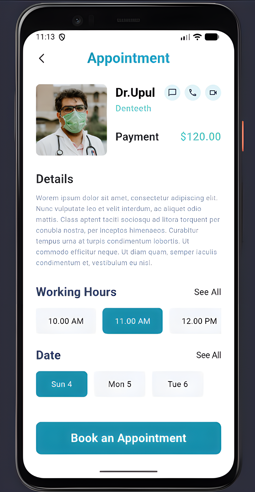

# Medical Appointment State Management

<table align="center">
  <tr>
    <td align="center">
      
    </td>
    <td align="center">
      
    </td>
  </tr>
</table>

## Overview

Medical Appointment State Management is a cross-platform mobile application built with Flutter that
lets users browse doctors, book medical appointments, and manage their healthcare schedule. The
data is loaded asynchronously from a JSON file, and the whole application state is managed with the
BLoC pattern (`Cubit`), separating the UI from the data and the business logic.

## Features

- **Centralized State Management**: A single `AppCubit` holds the application state (loading
  status, data, search query, filter, sort and selections) and rebuilds only the widgets that depend
  on it.
- **Asynchronous Data Loading**: The data is read from a local JSON file through a repository, with
  explicit `loading`, `success`, `empty` and `error` states and a **Try again** button on failure.
- **Search, Filter and Sort**: Search doctors by name or specialty, filter by all doctors or
  favorites, and sort by name or specialty.
- **Favorite Doctors**: Mark or unmark a doctor as favorite with a single tap, and the state
  updates immediately.
- **Appointment Booking**: Pick a working hour and a date, then confirm the booking. The selected
  date and time are kept in the state and confirmed with a message.
- **Appointment Details**: View doctor info, payment summary, and contact options (chat, call,
  video).
- **Clean Architecture**: Models, repository, state, screens, and reusable widgets are separated
  into dedicated files for readability and maintainability.

## Technologies

- **Framework**: Flutter
- **Language**: Dart
- **State Management**: flutter_bloc (Cubit)
- **UI Toolkit**: Material Design 3
- **Libraries**: flutter_bloc, flutter_svg
- **Data Source**: Local JSON asset
- **Development Tools**: Android Studio
- **Version Control**: Git, GitHub

## Project Structure

```
lib/
├── main.dart
├── app.dart
├── core/
│   ├── constants/
│   │   └── app_colors.dart
│   └── widgets/
│       └── data_image.dart
├── models/
│   ├── app_data.dart
│   └── doctor.dart
├── repositories/
│   └── app_repository.dart
├── state/
│   ├── app_cubit.dart
│   ├── app_state.dart
│   └── load_status.dart
├── screens/
│   ├── home/
│   │   └── home_screen.dart
│   └── appointment/
│       └── appointment_details_screen.dart
└── widgets/
    ├── common/
    │   └── section_title.dart
    ├── home/
    │   ├── home_header.dart
    │   ├── search_bar.dart
    │   └── health_services.dart
    ├── doctor/
    │   └── doctor_tile.dart
    └── appointment/
        ├── appointment_card.dart
        ├── appointment_header.dart
        ├── appointment_doctor_info.dart
        ├── working_hours.dart
        ├── appointment_dates.dart
        ├── edit_button.dart
        └── book_appointment_button.dart
assets/
└── data/
    └── lab_v2.json
```

## State Management

The application follows a unidirectional data flow:

```
 UI (screens, widgets)
        │  user action (search, favorite, select hour/date)
        ▼
    AppCubit  ──── load() ────►  AppRepository  ──►  lab_v2.json
        │                                │
        │ emit(new AppState)             │ AppData (models)
        ▼                                ▼
    AppState  ◄──────────────────────────┘
        │
        ▼
 BlocBuilder rebuilds the UI
```

| Component | Role |
|---|---|
| `AppRepository` | Reads and decodes the JSON asset and returns an `AppData` object |
| `AppCubit` | Loads the data and exposes methods to change the state |
| `AppState` | Immutable state with `copyWith` and the `visibleDoctors` getter that applies search, filter and sort |
| `LoadStatus` | Enum with the states `initial`, `loading`, `success`, `empty`, `error` |
| `Doctor`, `AppData` | Models created from JSON |

### Cubit Methods

| Method | Action |
|---|---|
| `load()` | Loads the data and sets the initial hour and date |
| `search(value)` | Updates the search query |
| `setFilter(value)` | Switches between all doctors and favorites |
| `setSort(value)` | Sorts the doctors by name or specialty |
| `toggleFavorite(id)` | Marks or unmarks a doctor as favorite |
| `selectHour(index)` | Selects a working hour |
| `selectDate(index)` | Selects an appointment date |

## Resources

- [Learn Flutter](https://docs.flutter.dev/get-started/learn-flutter)
- [Write your first Flutter app](https://docs.flutter.dev/get-started/codelab)
- [Flutter state management](https://docs.flutter.dev/data-and-backend/state-mgmt/options)
- [flutter_bloc package](https://pub.dev/packages/flutter_bloc)

## Installation

To install and run the application, follow these steps:

1. **Clone this repository:**
```bash
git clone https://github.com/Constantin-Stamate/medical-appointment-state-management
```

2. **Navigate to the project directory:**
```bash
cd medical-appointment-state-management
```

3. **Install dependencies:**
```bash
flutter pub get
```

4. **Run the application:**
```bash
flutter run
```

## Contributors

**Medical Appointment State Management** was developed as part of the Mobile Application
Development laboratory works.

- GitHub: [Constantin-Stamate](https://github.com/Constantin-Stamate)
- Email: constantinstamate.r@gmail.com